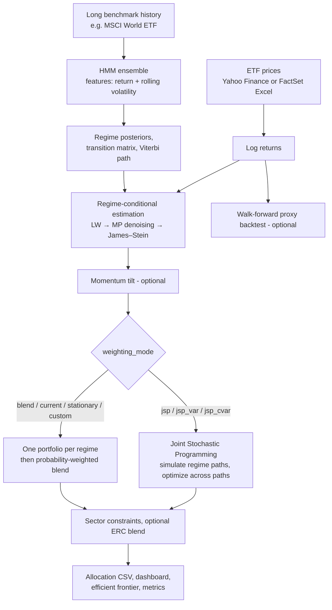

# HMM Regime-Switching ETF Portfolio Optimizer

A research-grade Python framework that builds a long-only, sector-constrained ETF portfolio by combining

1. a **Hidden Markov Model (HMM)** that detects market regimes (Bull / Sideways / Bear),
2. a **regime-conditional estimation pipeline** for expected returns and covariances (Ledoit–Wolf → Marchenko–Pastur denoising → James–Stein shrinkage),
3. a **Joint Stochastic Programming (JSP)** optimizer that simulates thousands of future regime paths from today's regime distribution and optimizes the portfolio across those paths.

A classical alternative (one mean-variance portfolio per regime, blended by regime probabilities) is also included for comparison.

> **Disclaimer.** This project is for research and educational purposes only. It is not investment advice. Outputs depend heavily on the input data, the configured priors and the model assumptions. For other consideration check the OPERATIONAL PREMISES file .

---

## Table of contents

- [Why regime-aware optimization?](#why-regime-aware-optimization)
- [Design highlights](#design-highlights)
- [Pipeline overview](#pipeline-overview)
- [Methodology](#methodology)
  - [1. Data](#1-data)
  - [2. Regime detection with an HMM ensemble](#2-regime-detection-with-an-hmm-ensemble)
  - [3. Regime-conditional estimation of μ and Σ](#3-regime-conditional-estimation-of-μ-and-σ)
  - [4. Optimization](#4-optimization)
  - [5. Reported metrics](#5-reported-metrics)
- [Code structure](#code-structure)
- [Installation](#installation)
- [Quick start](#quick-start)
- [Configuration reference](#configuration-reference)
- [Outputs](#outputs)
- [Validation and diagnostics](#validation-and-diagnostics)
- [Known limitations](#known-limitations)
- [References](#references)

---

## Why regime-aware optimization?

Classical mean-variance optimization (Markowitz, 1952) estimates a single expected-return vector and a single covariance matrix from the whole sample. Financial markets, however, alternate between states with very different behaviour: calm uptrends, choppy sideways markets and high-volatility drawdowns. Returns, volatilities and, crucially, correlations change from one state to another, so a single pooled estimate is a poor description of any of them.

This project models that structure explicitly:

- the **state of the market** is a latent variable inferred by an HMM from a long benchmark history;
- the **parameters of each state** (μₖ, Σₖ) are estimated separately, with heavy statistical regularization because each regime contains few observations;
- the **future** is represented as a distribution of regime paths (a Markov chain started from today's regime probabilities), and the portfolio is optimized against that distribution rather than against a single point estimate.

---

## Design highlights

| Component | What it does | Why it matters |
|---|---|---|
| **HMM ensemble with state alignment** | Trains several HMMs (different seeds), aligns their hidden states to the best model with Hungarian matching on emission parameters, and averages their posteriors with likelihood-based weights. | Avoids *label switching* between ensemble members; posteriors stay consistent with the transition matrix and regime labels. |
| **Posterior probability floor** | Clips each regime probability to a minimum (default 3%). | Prevents degenerate "100% one regime" inputs to the simulator. |
| **Economic regime mapping** | Maps unlabeled HMM states to Bull / Sideways / Bear using a composite score of mean return, volatility, persistence and drawdown. | Makes results interpretable and stable across re-fits. |
| **Three-layer covariance estimation** | Ledoit–Wolf shrinkage → Marchenko–Pastur eigenvalue denoising → blended back with Ledoit–Wolf. | Short per-regime samples (tens to hundreds of days) with many assets produce very noisy sample covariances. |
| **Sample-length-adaptive James–Stein shrinkage of μ** | Shrinks each regime's mean toward forward-looking sector priors; the intensity depends on series length, regime sample size and number of assets. | Sample means from 1–3 years of data are dominated by noise; shrinkage keeps expected returns economically plausible. |
| **Forward-looking JSP** | Simulates Markov regime paths starting from today's *smoothed probability vector* (not a hard label) and optimizes across paths. | The portfolio reflects both the current regime and the long-run regime mix implied by the transition matrix. |
| **Nested cross-validation on simulated paths** | Multi-start solutions are fitted on 70% of the paths and selected on the held-out 30%. | Reduces selection bias among local optima. |
| **Sector constraints with feasibility checks** | Per-sector min/max bounds, a post-optimization projection, and a `validate_config()` pre-flight check. | Enforces structural diversification and catches silent configuration errors (e.g. a sector name typo). |
| **Transaction-cost and turnover awareness** | Optional L1 cost (bps) and L2 turnover penalty relative to previous weights. | Supports periodic re-optimization without excessive trading. |

---

## Pipeline overview



---

## Methodology

### 1. Data

- **Source:** Yahoo Finance (adjusted close prices via `yfinance`) or an Excel file (e.g. a FactSet export). Tickers missing from the Excel file are downloaded from Yahoo.
- **Returns:** daily log returns. Short gaps caused by different exchange calendars are forward-filled (up to 5 days) so that one holiday does not delete observations for all ETFs.
- **Two histories:** the ETFs use `period_years` of data (default 5), while the regime detector uses a much longer benchmark history (`benchmark_period_years`, e.g. 15–20 years of a broad equity ETF). This lets the HMM observe several full market cycles even if some ETFs are young.
- **Sample alignment:** regime labels are aligned to ETF returns by date, not by position, because ETFs listed on different exchanges have different trading calendars.

### 2. Regime detection with an HMM ensemble

**Observations.** Two standardized features of the benchmark: the daily log return and its rolling volatility (window `volatility_window`, default 10 days).

**Model.** A Gaussian HMM (`hmmlearn`) with `n_regimes` hidden states (default 3), full covariance, trained with Baum–Welch.

**Ensemble.** `hmm_n_ensemble` models are trained with different random seeds. They are combined as follows:

1. The model with the highest log-likelihood is the *reference*; its state ids define the labelling used everywhere (transition matrix, Viterbi path, regime mapping).
2. Every other model's states are matched to the reference by minimizing the distance between emission fingerprints (means and standard deviations) with the Hungarian algorithm.
3. Posteriors are averaged with weights proportional to `exp(logL − max logL)` (Akaike-style weights for equal-size models).
4. A floor `regime_prob_floor` is applied and probabilities are renormalized.

A consistency check prints the agreement between the Viterbi path and the arg-max of the ensemble posterior; a low value signals unreliable regime labelling.

**Economic labelling.** HMM states are unordered, so each state is scored on mean return, volatility, persistence (share of time) and maximum drawdown measured in the benchmark's real return space. The highest "bull score" is labelled _Bull_, the highest "bear score" _Bear_, and the remaining state _Sideways/Kangaroo_.

**Smoothing "today".** The starting distribution for the simulation is an exponentially weighted average of the last `regime_smoothing_window` daily posteriors (decay `regime_smoothing_decay`), which filters one-day noise.

### 3. Regime-conditional estimation of μ and Σ

For each regime *k*, the ETF returns observed on days assigned to that regime (Viterbi path) are used. If a regime has fewer than 15 observations, the full-sample series is used together with strong shrinkage.

**Covariance Σₖ (three layers).**

1. **Ledoit–Wolf** shrinkage toward a structured target.
2. **Marchenko–Pastur denoising** of the correlation matrix: eigenvalues above the MP upper edge λ₊ = (1+√(N/T_eff))² are kept as signal (with a minimum share of eigenvalues retained), the remaining ones are replaced by their average. The effective sample size T_eff accounts for return autocorrelation.
3. **Blending** the denoised matrix with the Ledoit–Wolf matrix, with weight α = 30 / (30 + T) on Ledoit–Wolf, so shorter samples lean more on the more conservative estimator.

**Expected returns μₖ (James–Stein shrinkage).**

$$
\hat\mu_k = (1-\gamma_k)\,\bar\mu_k + \gamma_k\,\mu^{\text{prior}}, \qquad
\gamma_k = \frac{c_k}{c_k + n_k}, \qquad
c_k = C \cdot \max\!\left(1, \sqrt{60 / n_k}\right)
$$

- $\bar\mu_k$ is the annualized sample mean in regime *k*, $n_k$ the number of observations.
- $\mu^{\text{prior}}$ is a forward-looking prior per sector set in `sector_priors` (optionally date-stamped with `prior_schedule` to avoid look-ahead).
- The base intensity $C$ depends on the ETF history length: 80 (< ~1 year), 50 (< ~2 years), 35 (< ~3 years), 20 otherwise, and is never below an *N-aware floor* of $2(N-2)$ for $N$ assets.

**Safety nets.**

- μ is clipped to $[-50\%,\ \min(r_f + 1.8\,\bar\sigma_k,\ 20\%)]$ per year, i.e. a Sharpe-ratio ceiling tied to the regime's average volatility plus an absolute cap.
- Optional per-regime μ floors (`regime_mu_floors`).

**Momentum tilt (optional).** A cross-sectional 12-1 momentum z-score (winsorized at ±2) shifts each regime's μ by `z × momentum_tilt × (cross-sectional std of μ)`. The console prints the tilt actually applied to each ETF.

### 4. Optimization

Two families of methods share the same regime statistics. Select one with `weighting_mode`.

#### A. Joint Stochastic Programming (`jsp`, `jsp_var`, `jsp_cvar`)

**Scenario generation.** The HMM transition matrix **A** drives a Markov chain. `jsp_n_sequences` paths of length `jsp_seq_length` trading days are simulated. The first state of each path is drawn from today's smoothed regime distribution (`regime_start_mode = "today_probs"`), from a blend with the stationary distribution π (`"blended"`), or from the arg-max state (`"current"`). The simulator is vectorized across paths.

**Path statistics.** For path *i* with regime occupation shares $f_{ik}$ and horizon-scaled parameters $\mu_k^{(H)}$, $\Sigma_k^{(H)}$:

$$
R_i(w) = \sum_k f_{ik}\; w^\top \mu_k^{(H)}, \qquad
V_i(w) = \sum_k f_{ik}\; w^\top \Sigma_k^{(H)}\, w
$$

**Objectives.**

| `weighting_mode` | Objective |
|---|---|
| `jsp` | Maximize $\dfrac{\bar R(w) - r_f H/252}{\sqrt{\bar V(w)}}$ (averages over paths, net of costs) |
| `jsp_var` | Minimize the average Gaussian VaR: $-\frac1N\sum_i \left(R_i + z_\alpha \sqrt{V_i}\right)$ |
| `jsp_cvar` | Minimize the average Gaussian CVaR: $\frac1N\sum_i \left(-R_i + \sqrt{V_i}\,\varphi(z_\alpha)/\alpha\right)$ |

Optional terms: L1 transaction cost (`transaction_cost_bps`) and L2 turnover penalty (`l2_turnover_penalty`) relative to previous weights, and a return tilt (`return_tilt`) that blends the Sharpe objective with expected return.

**Constraints.** Fully invested, long-only, per-asset bounds `[min_weight, max_weight]`, per-sector `[min, max]` bounds (`sector_constraints`).

**Solver and selection.**

- SLSQP with 16 starting points: sparse Dirichlet(0.3), uniform Dirichlet(1), μ-proportional with log-normal noise, diversified Dirichlet(3) and one sector-feasible start.
- Nested CV: each start is optimized on 70% of the simulated paths; the candidate with the best objective on the remaining 30% is selected.
- A projection step enforces sector constraints if the solution violates them, and an optional ERC blend (`erc_blend`) mixes in an Equal-Risk-Contribution portfolio for structural diversification.

#### B. Classical regime-weighted mean-variance (`blend`, `current`, `stationary`, `custom`, `market_analysis`)

1. One portfolio is optimized per regime (maximum Sharpe by default, solved with CVXPY/CLARABEL and SciPy SLSQP, keeping the better result; optional return tilt, volatility target or ERC blend).
2. The regime portfolios are combined with regime probabilities:
   - `current`: today's posterior;
   - `stationary`: long-run distribution of the transition matrix;
   - `blend`: `blend_alpha × current + (1 − blend_alpha) × stationary`;
   - `custom`: user-defined weights (`custom_regime_weights`);
   - `market_analysis`: fixed weights from a macro view hard-coded in the class.

### 5. Reported metrics

The console report shows two readings:

- **JSP view:** expected return, volatility and Sharpe ratio of the chosen weights using the average regime mix of the simulated paths. This is the model's forward-looking estimate.
- **Reporter view:** the same weights evaluated with μ and Σ averaged using the smoothed current regime distribution (including the momentum tilt). It is a contextual cross-check; a large gap between the two means that today's regime differs from the long-run mix.

It also prints the naive trailing-12-month return of the final weights next to the benchmark, explicitly flagged as in-sample (look-ahead).

---

## Code structure

The project is a single file, `hmm_portfolio_optimizer.py`, organized in sections.

| Section | Class / function | Responsibility |
|---|---|---|
| Utilities | `_mp_denoise_covariance` | Marchenko–Pastur eigenvalue denoising of a Ledoit–Wolf covariance. |
| 1. Data | `DataLoader` | Yahoo/Excel loading, log returns, gap forward-filling, ticker/label safety. |
| 2. HMM | `MarketRegimeHMM` | Ensemble fit, state alignment, economic mapping, regime statistics (LW + MP + James–Stein), momentum tilt, HMM validation, transition-matrix printing. |
| 3. MVO | `RegimeMVOptimizer` | Per-regime max-Sharpe (CVXPY / SciPy), return tilt, volatility target, ERC. |
| 4. Weighting | `RegimeProbabilityWeighter` | Combines regime portfolios (current / stationary / blend / custom). |
| 4B. JSP | `JointStochasticOptimizer` | Markov path simulation, Sharpe / VaR / CVaR objectives, costs, multi-start SLSQP, nested CV, sector enforcement, ERC blend. |
| 5. Reporting | `PortfolioReporter` | Console report, six-panel dashboard, efficient frontier. |
| Pipeline | `validate_config`, `HMMPortfolioOptimizer` | Configuration checks and end-to-end orchestration (`run()`). |
| 7. Backtest | `WalkForwardValidator` | Optional walk-forward proxy backtest. |
| Config | `CONFIG` | All user-facing settings. |

---

## Installation

Requires **Python 3.10+**. The code has been exercised with Python 3.12, NumPy 2.x, pandas 3.x, scikit-learn 1.8, `hmmlearn` 0.3 and CVXPY 1.9.

```bash
git clone https://github.com/<your-user>/<your-repo>.git
cd <your-repo>
python -m venv .venv && source .venv/bin/activate      # Windows: .venv\Scripts\activate
pip install numpy pandas scipy scikit-learn hmmlearn matplotlib openpyxl yfinance cvxpy
```

`cvxpy` is optional (the code falls back to SciPy); `yfinance` is only needed when downloading from Yahoo Finance; `openpyxl` is only needed for Excel input.

---

## Quick start

1. Open `hmm_portfolio_optimizer.py` and edit the `CONFIG` dictionary at the bottom: ETF tickers, sector map, sector constraints and sector priors.
2. Run:

```bash
python hmm_portfolio_optimizer.py
```

Or use it as a library:

```python
from hmm_portfolio_optimizer import HMMPortfolioOptimizer, CONFIG

config = dict(CONFIG)
config["weighting_mode"] = "jsp_cvar"      # jsp | jsp_var | jsp_cvar | blend | current | stationary | custom
config["show_plots"] = False

allocation = HMMPortfolioOptimizer(config).run()
print(allocation)
```

**Minimal configuration example**

```python
CONFIG = {
    "etf_tickers": ["IWDA.AS", "EUHA.DE", "AUCO.MI", "XAIX.DE"],   # first ticker = benchmark for the HMM
    "sector_map": {
        "IWDA.AS": "MSCI World", "EUHA.DE": "Fixed Income",
        "AUCO.MI": "Commodities", "XAIX.DE": "Tech & AI",
    },
    "sector_priors": {"MSCI World": 0.08, "Fixed Income": 0.03, "Commodities": 0.065, "Tech & AI": 0.12},
    "sector_constraints": {"MSCI World": (0.10, 0.40), "Fixed Income": (0.10, 0.40),
                           "Commodities": (0.05, 0.30), "Tech & AI": (0.05, 0.30)},
    "min_weight": 0.02, "max_weight": 0.40,
    "weighting_mode": "jsp",
    # ... see the configuration reference for all other options
}
```

> **Tip.** Sector names in `sector_map`, `sector_priors` and `sector_constraints` must match exactly. `validate_config()` runs automatically and warns about mismatches or infeasible constraints before anything is estimated.

---

## Configuration reference

| Key | Meaning |
|---|---|
| `etf_tickers`, `sector_map` | Investment universe and sector of each ETF. The **first ticker is the HMM benchmark** unless `benchmark_ticker` is set. |
| `period_years`, `benchmark_period_years` | History length for the ETFs and for the regime detector. |
| `excel_file_path` | Use an Excel file instead of Yahoo Finance (`None` = Yahoo). |
| `n_regimes`, `volatility_window`, `hmm_iterations`, `hmm_n_ensemble` | HMM size, volatility feature window, Baum–Welch iterations, ensemble size. |
| `regime_prob_floor` | Minimum probability per regime (0.03–0.10 typical). |
| `regime_smoothing_window`, `regime_smoothing_decay` | Days (and recency decay) used to smooth today's regime distribution. |
| `sector_priors`, `prior_schedule` | Forward-looking annual return priors used as James–Stein targets (static or dated). |
| `regime_mu_floors` | Optional lower bounds on μ per regime. |
| `use_mp_denoising` | Toggle Marchenko–Pastur denoising. |
| `momentum_tilt`, `momentum_window_long/short` | Strength and windows of the optional momentum tilt (0 = off). |
| `weighting_mode` | `jsp`, `jsp_var`, `jsp_cvar`, `blend`, `current`, `stationary`, `custom`, `market_analysis`. |
| `jsp_n_sequences`, `jsp_seq_length` | Number of simulated regime paths and horizon in trading days (756 ≈ 3y, 1260 ≈ 5y). |
| `regime_start_mode`, `stationary_blend_alpha` | `today_probs`, `blended` or `current`; weight of π in the blended start. |
| `var_confidence`, `cvar_alpha` | Tail levels for `jsp_var` / `jsp_cvar`. |
| `risk_free_rate` | Risk-free rate used in Sharpe objectives. |
| `min_weight`, `max_weight`, `sector_constraints` | Asset and sector bounds. |
| `objective_mode`, `return_tilt`, `vol_target` | `max_sharpe`, `blended`, `max_return`, `vol_target`; blend between Sharpe and return; volatility cap. |
| `erc_blend` | Share of an Equal-Risk-Contribution portfolio mixed into the result (0 = off). |
| `use_nested_cv`, `nested_cv_ratio` | Enable and set the train fraction of the nested CV on simulated paths. |
| `l2_turnover_penalty`, `transaction_cost_bps` | Turnover regularization and explicit trading cost. |
| `run_hmm_validation` | Train/test log-likelihood gap, silhouette score and regime sample sizes. |
| `run_walkforward`, `wfo_train_months`, `wfo_rebal_months`, `wfo_protocol`, `oos_gap_days`, `wfo_start_date` | Walk-forward proxy backtest settings. |
| `show_plots`, `save_plot_path`, `output_csv` | Output options. |

---

## Outputs

- **Console report:** data diagnostics, HMM diagnostics, regime statistics, momentum tilt table, JSP summary, final allocation by ETF and by sector, and the two-view metrics.
- **`portfolio_allocation.csv`:** columns `Ticker`, `Sector`, `Weight_Pct`.
- **`portfolio_dashboard.png`:** allocation pie, sector bars, current regime probabilities, regime probability history, regimes on the benchmark's cumulative return, weights by regime and the efficient-frontier panel (a separate frontier image is also saved for the JSP mode).

## Example results and how to read them
 
The console report ends with two readings of the same portfolio. The figures below come from one example run (1500 simulated paths × 756 days, 21-day regime smoothing, risk-free rate 3%). They depend on the data date and on the configuration, and they are model-implied expectations, not realized performance or forecasts.
 
| | Expected return (p.a.) | Expected volatility (p.a.) | Sharpe ratio |
|---|---|---|---|
| **① JSP** (forward-looking, average regime mix of the simulated paths) | 11.22% | 12.31% | 0.668 |
| **② Reporter** (today's smoothed regime distribution, context only) | 13.40% | 9.37% | 1.109 |
| Δ Reporter vs JSP | +2.18 pp | −2.94 pp | +0.441 |
 
**What the two views mean**
 
- **JSP is the primary estimate.** It averages the regime parameters over the regime mix that the Markov chain is expected to visit during the next 756 trading days, starting from today's distribution and drifting toward the long-run mix. A Sharpe ratio of about 0.67 is a plausible order of magnitude for a diversified, long-only, multi-asset ETF portfolio. A value well above 1.5 would be a warning sign of over-optimistic inputs rather than a success.
- **Reporter is a conditional snapshot.** It uses the same weights but weights each regime's μ and Σ by *today's* smoothed regime probabilities. If today's regime is calmer and stronger than the long-run average, it shows higher return and lower volatility than the JSP, as in this run. It describes the short-term outlook if the current regime persisted, not the multi-year expectation.
- **Reading the gap.** The +2.18 pp return gap and −2.94 pp volatility gap indicate that the current regime is more favourable than the long-run mix assumed by the JSP. Both views use the same regime parameters (including the optional momentum tilt), so the difference is mainly due to the regime mix, not to the tilt. A large gap is a signal that the portfolio is exposed to a regime change: the JSP view is the one to rely on for the strategic horizon.
- **Consistency check.** Sharpe = (return − r_f) / volatility holds for both rows: (11.22 − 3.0) / 12.31 ≈ 0.668 and (13.40 − 3.0) / 9.37 ≈ 1.11.
  
---

## Validation and diagnostics

- **`validate_config()`** (automatic): duplicate tickers, tickers without sector, sectors without a prior, constraints on unknown sectors, infeasible per-asset or per-sector bounds, `return_tilt` range.
- **HMM quality** (run_hmm_validation): train/test log-likelihood per observation and its gap, silhouette score of the regimes in feature space, and the number of observations per regime.
- **Posterior/Viterbi agreement:** printed after every fit.
- **Walk-forward proxy** (run_walkforward): rolling or expanding windows with an embargo (`oos_gap_days`) between training and test, explicit transaction costs, and metrics (annualized return and volatility, Sharpe, Sortino, maximum drawdown, Calmar, VaR/CVaR) compared with the benchmark. See the limitation below: it does not re-fit the HMM or the JSP.

---

## Known limitations

Being explicit about what the model does NOT do is part of using it responsibly.

1. **Short ETF histories.** The ETF sample is the intersection of all ETF histories, so the youngest ETF sets the length. Regime-conditional estimates then rest on a few dozen to a few hundred days and rely on shrinkage and priors; the sector priors are subjective inputs that materially affect the result.
2. **JSP objective and Monte-Carlo noise.** For `jsp` (max average Sharpe), the objective depends on the simulated paths only through their *average* regime occupation, so the extra paths mostly add sampling noise. The VaR/CVaR objectives do use path dispersion. A per-path Sharpe objective would exploit scenario dispersion more fully.
3. **Walk-forward is a proxy.** Each window re-estimates a James–Stein max-Sharpe portfolio; the HMM regimes and the JSP are not re-fitted per window, so the backtest does not validate the full model.
4. **In-sample regime history.** The HMM is trained on the whole benchmark history; historical regime labels and regime-conditional estimates are therefore in-sample. The posterior for the last observation is equivalent to the filtered probability, so *today's* regime reading uses no future data, but historical plots do.
5. **Regime-mixture variance.** Reported volatility averages regime covariances and ignores the variance contributed by differences in regime means (law of total variance), which makes it slightly optimistic.
6. **Momentum overlaps with sample means.** Past returns already enter the regime sample means, especially with short histories; the momentum tilt can partly double-count that signal.
7. **Distributional assumptions.** Gaussian emissions in the HMM, Gaussian VaR/CVaR in the objectives, and i.i.d. returns within a regime.
8. **Some constants are fixed in code**, e.g. the 3% risk-free rate used in the μ-clipping ceiling and in the walk-forward metrics.
9. **Data quality.** Yahoo Finance tickers can change or disappear; always verify tickers before running.

---


## References

- Markowitz, H. (1952). *Portfolio Selection.* Journal of Finance.
- Hamilton, J. D. (1989). *A New Approach to the Economic Analysis of Nonstationary Time Series and the Business Cycle.* Econometrica.
- Rabiner, L. R. (1989). *A Tutorial on Hidden Markov Models and Selected Applications in Speech Recognition.* Proceedings of the IEEE.
- Jorion, P. (1986). *Bayes–Stein Estimation for Portfolio Analysis.* Journal of Financial and Quantitative Analysis.
- Ledoit, O. & Wolf, M. (2004). *A Well-Conditioned Estimator for Large-Dimensional Covariance Matrices.* Journal of Multivariate Analysis.
- Laloux, L., Cizeau, P., Bouchaud, J.-P. & Potters, M. (1999). *Noise Dressing of Financial Correlation Matrices.* Physical Review Letters.
- Jegadeesh, N. & Titman, S. (1993). *Returns to Buying Winners and Selling Losers.* Journal of Finance.
- Maillard, S., Roncalli, T. & Teïletche, J. (2010). *The Properties of Equally Weighted Risk Contribution Portfolios.* Journal of Portfolio Management.
- Rockafellar, R. T. & Uryasev, S. (2000). *Optimization of Conditional Value-at-Risk.* Journal of Risk.
- Wang, J., Zhang, T. et al. (2020). Regime-switching portfolio optimization with HMMs, *Journal of Risk and Financial Management* 


